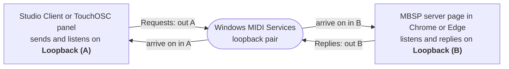

# MIDI Bulk Storage Protocol (MBSP)

MBSP lets any MIDI device save and recall its own bulk data on a storage server reachable over an ordinary MIDI connection. That data can be patches, banks, performances, drum kits, sequences, tunings or calibration data. The device starts every operation itself, so you don't need instrument-specific librarian software: one MBSP server can serve every MBSP-capable device in a studio.

MBSP is carried entirely in Universal Non-Real Time System Exclusive messages. It works over MIDI 1.0 DIN, USB MIDI and any transport that carries MIDI 1.0 SysEx, including MIDI 2.0 UMP Data 64 messages. The protocol defines:

- server discovery;
- acknowledged block-by-block transfer, with checksums and recovery of lost messages;
- server-assigned record IDs and atomic replacement of stored records;
- filtered, paged queries and owner-checked deletion;
- optional client discovery, so a server can list the devices present;
- optional Offers, with which a server's user sends a record to a device that accepts it;
- a classification of bulk data types.

> **Status:** Version 1.0 Draft 3. This is a draft proposal to the MIDI Manufacturers Association (MMA) and the Association of Musical Electronics Industry (AMEI). It has not been adopted and may change substantially. The SysEx Sub-ID it uses (`6Ah`) is a placeholder until the MMA and AMEI assign one, so don't use it in shipping products.

## The specification

**[MBSP Specification v1.0 Draft 3 (PDF)](docs/MBSP-Specification-v1.0-Draft3.pdf)**

The PDF is built from [`docs/src/mbsp-spec.html`](docs/src/mbsp-spec.html). Section 12 of the specification lists open issues on which the proposer asks for reviewers' guidance.

## Try it in your browser

**[Open the MBSP WebMIDI Server](https://midihax.github.io/midi-bulk-storage-protocol/sample-server/)**

The server runs in the page itself. You need Chrome or Edge (Firefox works too, after its Web MIDI permission prompt). Click **Connect MIDI**, allow SysEx access, and choose the MIDI ports to listen and reply on. Records are kept in the browser's own database. Safari has no Web MIDI, so the server doesn't run there.

## Reference implementations

| Folder | What it is |
|---|---|
| [`sample-server/`](sample-server/) | **WebMIDI Server.** A complete MBSP server in a web page. It has a record browser, import and export of the whole database, and a built-in protocol self-test. Records are stored in the browser's IndexedDB. |
| [`sample-client/`](sample-client/) | **Studio Client.** A Node.js test client that emulates a studio of ten devices. It exercises every message, every Query filter and the error cases, and checks every reply byte for byte. |
| [`touchosc-panel/`](touchosc-panel/) | **TouchOSC Snapshot Panel.** A small demonstration client built as a TouchOSC control surface. It saves snapshots of its controls to an MBSP server and restores them. |
| [`docs/`](docs/) | The specification PDF and its HTML source. |

The server and the Studio Client share one protocol codec, [`sample-server/js/mbsp-protocol.js`](sample-server/js/mbsp-protocol.js). Each folder's README covers setup and wiring in detail.

## Quick start

Run the server locally, or use the hosted page above:

```
cd sample-server
npx serve .            # or: python -m http.server 8000
```

Then open the address it prints on `localhost`. Web MIDI needs a secure context, and `localhost` counts as one.

Run the Studio Client against a server:

```
cd sample-client
npm install
npm run ports          # list the MIDI ports Node can see
npm start              # 100 random operations
```

The client and server must be connected through a MIDI loopback, so that what one sends the other receives. On Windows, MIDI Services provides loopback pairs that are cross-wired: whatever is sent on one side arrives on the other.



On the server page, enable only `Loopback (B)`, under both Inputs and Outputs. If a second input carries the same traffic, every request arrives twice. Several clients and several server pages (`index.html?instance=A`, `?instance=B`) can share the same pair. [`sample-client/README.md`](sample-client/README.md) has more detail.

## Tests

```
node sample-server/test/run-tests.js            # server self-test under Node
cd touchosc-panel && npm install && npm test    # rebuilds the .tosc and tests the panel script
```

[`sample-server/test/browser-test.html`](sample-server/test/browser-test.html) runs the IndexedDB store tests and the self-test in a browser.

## Building the PDF

[`docs/src/build-pdf.js`](docs/src/build-pdf.js) renders the HTML with headless Chrome. It then uses Python with `pypdf` to fill in the table-of-contents page numbers and the document metadata.

```
cd docs/src
node build-pdf.js
```

## Feedback

Comments on the protocol are welcome. Please open an issue.

## License

The reference implementations in this repository are released under the [MIT License](LICENSE). The specification is a draft proposal to the MMA and AMEI.
